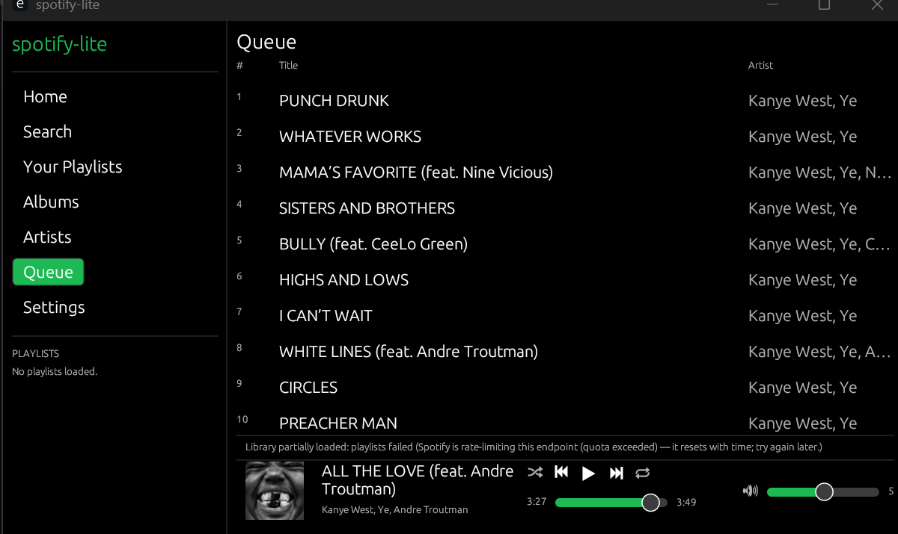

# spotify-lite

A featherweight, native Spotify desktop client for Windows — your library, search, queues and
transport controls in a ~50 MB Rust app with a proper Spotify-dark UI. Audio is streamed by
**Spotify's own [Soloist](https://developer.spotify.com/documentation/soloist)** engine running
headlessly on your PC, so playback works on accounts that third-party engines can no longer serve.

Built with [egui](https://github.com/emilk/egui) + [tokio](https://tokio.rs). No Electron, no
webview, no browser.



## Why this exists

The official Spotify desktop app is an Electron application — hundreds of megabytes of RAM for a
music player. This project started as a from-scratch native client using
[librespot](https://github.com/librespot-org/librespot) for playback, and the browsing half worked
beautifully. Then Spotify changed the rules, twice:

1. **August 2026** — Spotify's `login5` endpoint stopped accepting playback credentials minted from
   third-party developer client IDs. Fixed here with a dual-identity login: your own developer app
   drives the Web API (library/search), while Spotify's own desktop client identity mints the
   playback token.
2. **The audio-key block** — since ~2024/2025, Spotify refuses to issue audio decryption keys
   (AP error `0x0001`, logged upstream as `error audio key 0 1`) to accounts created after a
   server-side cutoff. This is **account-level and permanent**, affects every librespot-based
   client ([librespot#1649](https://github.com/librespot-org/librespot/issues/1649),
   [#1735](https://github.com/librespot-org/librespot/issues/1735)), and has no client-side
   workaround — verified empirically against this project's own diagnostics (token sessions and
   stored-credential sessions both refused, every file format, metadata flowing fine).

spotify-lite's answer: keep librespot as the fallback engine for unaffected accounts, detect the
block at login and say so honestly, and drive **Spotify Soloist** — Spotify's official headless
Connect client — as the audio engine for everyone else. Your GUI stays exactly the same; only the
renderer changes.

## Features

- Library browsing: playlists, saved albums, followed artists (loaded independently — a
  rate-limited section no longer blanks the whole library)
- Search (tracks/albums/artists/playlists)
- Playlist/album views with double-click-to-play from any row, hearts (Liked Songs), and an
  **add-to-queue** ("+") action per track
- A real up-next **Queue screen**, fed live by the playback engine
- Full transport: play/pause/next/previous, seek bar with live position, volume, shuffle, repeat
- Now-playing bar with **cover art** and track metadata
- Dual playback engines with automatic routing: Soloist (official, works for all accounts) and
  librespot (fallback; auto-detected account block produces a clear in-app banner)
- Auto-detection of Soloist with reconnect/backoff and status hints
- Optional: librespot playback for accounts not affected by the audio-key block

## Requirements

- Windows 10/11 x64 (other platforms: untested; the code is cross-platform in principle)
- [Rust](https://rustup.rs) with the MSVC toolchain (Visual Studio Build Tools C++ workload)
- A **Spotify Premium** account
- A Spotify **developer app** client ID (free — [dashboard](https://developer.spotify.com/dashboard),
  redirect URI `http://127.0.0.1:8888/login`)
- [Spotify Soloist](https://developer.spotify.com/documentation/soloist) for playback (see below)

## Quick start

```bat
git clone https://github.com/GaelCT/Spotify-lite.git
cd Spotify-lite

:: Build (vcbuild.bat wraps cargo with the MSVC environment; cargo need not be on PATH)
vcbuild.bat build --release

:: Install Soloist: download the Windows x86_64 archive from Spotify's docs and unpack it, then:
%LOCALAPPDATA%\soloist\soloist.exe -n "spotify-lite" -k <YOUR_SOLOIST_API_KEY> --ws 127.0.0.1:9090
::   (key: Spotify developer dashboard → "Spotify Soloist API Key"; one-time)

:: Pair once: in the official Spotify app, pick the "spotify-lite" device from the device picker
:: and let a second of music play. The session persists across Soloist restarts.

target\release\spotify-lite.exe
```

Then: **Connect** in the app (approve the browser prompt), browse, double-click anything.
While Soloist is logged in, all playback routes to it; if Soloist stops, the app falls back to the
librespot engine automatically (and tells you, in the status line).

> Soloist builds **expire every 90 days** — when the app shows "Soloist not detected", re-download
> the current build from Spotify and restart it with the same command.

## How playback works

```
┌──────────────────────────── spotify-lite ────────────────────────────┐
│  egui UI ──UiCommand──▶ player worker (tokio)                        │
│                            │                                         │
│              browsing/search: Web API (your dev-app token)           │
│                            │                                         │
│              playback routing (worker picks per command):            │
│                Soloist live? ──yes──▶ Soloist WS 127.0.0.1:9090      │
│                     │no              (play/pause/skip/seek/vol/      │
│                     ▼                shuffle/repeat/add_to_queue)    │
│                librespot session ──▶ mixer/rodio ──▶ speakers        │
│                (audio-key block probe at login sets the              │
│                 playback_blocked flag → red banner, fail-fast plays) │
└──────────────────────────────────────────────────────────────────────┘
```

Soloist pushes events over its local WebSocket (`playback_state`, `track_changed`,
`position_sync`, `queue_changed`…), so the now-playing bar and queue update instantly with no
polling. State is normalized into the app's existing `PlayerSnapshot`, which keeps the UI identical
across engines.

## Configuration

`%APPDATA%\spotify-lite\config.toml` (edited from **Settings** too):

| Key | Default | Notes |
|---|---|---|
| `client_id` | — | your Spotify developer app client ID |
| `soloist_ws_addr` | `127.0.0.1:9090` | Soloist WebSocket address (loopback only; takes effect after restart) |

Token caches live in `%LOCALAPPDATA%\spotify-lite\cache\` (Web API token + Soloist playback token).
**Never commit these.**

## Limitations — read this before opening an issue

These are real, mostly external constraints, kept here so nobody burns an evening rediscovering them:

- **Account-cohort audio-key block.** Accounts created after Spotify's ~2024/2025 cutoff cannot
  receive audio keys on the legacy protocol, so the **librespot engine will never play audio for
  them** — no client-side fix exists (see librespot#1649). spotify-lite detects the refusal at
  login and shows a banner. Use Soloist (works for every account) or an unaffected older account.
- **Soloist is required for playback on affected accounts**, and its builds expire every 90 days.
- **Web API developer quotas.** Spotify heavily rate-limits developer apps per endpoint family
  (the playlist endpoints are the tightest). Heavy use yields `429 QUOTA_EXCEEDED`; the app now
  says so plainly and loads unaffected sections independently. Quotas recover with time.
- **No remove-from-queue.** Soloist's WebSocket API supports adding to the queue but has no remove
  command — no third-party client can delete queue entries today.
- **OAuth token refresh is not implemented** — expect a browser re-login roughly hourly (both
  identities).
- **Log truncation:** the log file is rewritten on every launch (forensics don't persist).
- **Display scaling quirk:** on small displays with >100% scaling the window is deliberately
  clamped to fit at startup; if it feels small, resize it freely (the clamp only ever fires once).
- Platform notes: developed and verified on Windows x64. Linux/macOS should mostly work (Soloist
  ships builds for both) but are untested.

## Troubleshooting

| Symptom | Cause | Fix |
|---|---|---|
| Red banner: "Spotify blocks audio playback for this account" | Your account is in the post-cutoff cohort (librespot engine) | Expected — run Soloist; the banner only shows when Soloist isn't driving |
| "Soloist not detected — start it with…" | Soloist not running (or its 90-day build expired) | Start Soloist with `--ws 127.0.0.1:9090`; re-download if expired |
| "Spotify is rate-limiting this endpoint (quota exceeded)" | Dev-app endpoint quota burned | Wait for the reset; browsing still works for unaffected sections |
| "failed to fetch the current user's playlists" (generic) | Other API failure | Check the client ID/redirect URI; try Settings → Refresh library |
| "Bad credentials" at startup | Cached token expired | Log out and Connect again |
| Login works, library loads, nothing audible | Soloist not active/paused elsewhere | Press play in the app; check Soloist isn't claimed by another device |
| Tracks skip instantly / no audio (librespot engine) | Audio-key block | Use Soloist |

## Development

```bat
vcbuild.bat check                          :: fast type-check (cargo is not on PATH)
vcbuild.bat build --release                :: optimized build
vcbuild.bat run --example soloist_probe    :: live Soloist WS diagnostic
vcbuild.bat run --example playback_probe   :: librespot audio-key probe (token + stored-cred sessions, all formats)
vcbuild.bat run --example webapi_probe     :: live Web API endpoint matrix
```

Layout: `src/ui/*` egui shell · `src/player.rs` backend worker + queue/routing · `src/soloist.rs`
Soloist WS client · `src/webapi.rs` rspotify client · `src/auth.rs` dual OAuth · `examples/*`
throwaway diagnostics (scaffolding, not CI). Design + plan docs:
`docs/superpowers/specs/`, `docs/superpowers/plans/`. Session history: `SESSION-2026-11-11.md`.

There is no test suite (by project convention); verification is compile-clean + live probes +
launch checks. The `playback_probe` example reproduces the audio-key block diagnosis end-to-end.

## Cost & provenance

Built almost entirely with AI pair-programming (Kimi Code), spec → plan → subagent-implemented
tasks → independent review passes. Measured orchestrator tokens for the Soloist integration:
~76k (plus ~5k for the preceding root-cause diagnosis goal); the 20+ subagent sessions are metered
separately and not included. Total across the two-day rescue-and-integration effort: well into the
hundreds of thousands of tokens. Worth it.

## License and legal

- This repository's code is MIT-licensed (see [LICENSE](LICENSE)).
- **Not affiliated with or endorsed by Spotify AB.** "Spotify" and related marks belong to Spotify.
- **Spotify Soloist is Spotify's software**, distributed under Spotify's terms: download it from
  Spotify's documentation yourself, do not redistribute its binaries, and bring your own Soloist
  API key and developer client ID. No keys, tokens, or credentials are or ever should be committed
  to this repository (a secret scan runs clean; `.gitignore` covers caches and logs).
